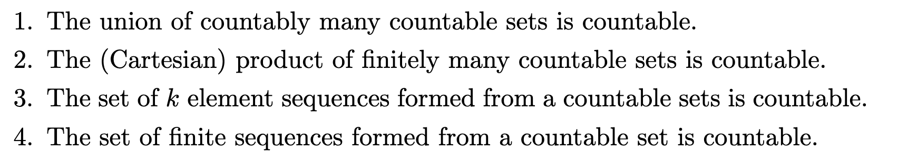
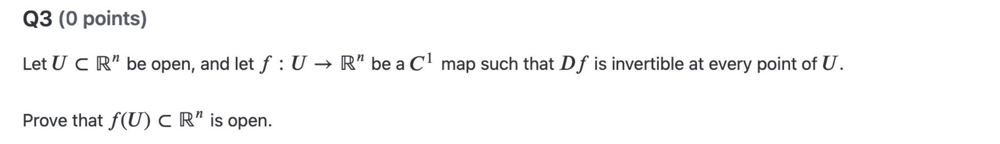
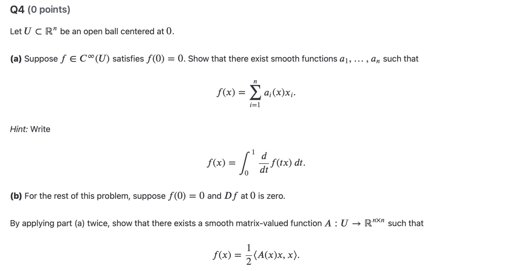

## Summary

### 1. Set theory
Conceptual:
1. equipotent/cardinality
2. THM: Cantor-Bernstein Theorem with proof
3. THM: finite set and a function
4. finite (alternative) by using $\prec$
5. countable

Problems:

---
### 2. Analysis II
Conceptual:
1. submanifold
2. regular value
3. regular value and submanifold (Regular Value Theorem)

    recognise submanifold without coordinate change
4. Claim: $O(n)$ is a submanifold

Problems:
Homework 4 Question 3:

Homework 4 Question 4ab:

---
### 3. Deutsch
1. Es sagt: Für Englischsprachige gehören Spanisch, Französisch, und Italienish zu den leichtesten Sprachen.

2. Das FSI bringt amerikanischen Diplomaten Sprachen bei.

a. 

    gehören + zu + Dativ: to belong to / to be part of / to be among

Ich gehöre zu dieser Gruppe.\
I belong to this group.

Deutsch gehört zu den germanischen Sprachen.\
German belongs to the Germanic languages.

Sie gehört zu meinen besten Freunden.\
She is one of my best friends.

Spanisch gehört zu den leichtesten Sprachen für Englischsprachige.
Spanish is among the easiest languages for English speakers.

b.

    beibringen: to teach someone something
Meine Mutter bringt mir Deutsch bei.\
My mother teaches me German.

Kannst du mir das beibringen?\
Can you teach me that?

c.

    leichtesten: easiest / lightest

Deutsch ist leichter als Russisch.\
German is easier than Russian.

Diese Aufgabe ist am leichtesten.\
This exercise is the easiest.

Das ist der leichteste Weg.\
This is the easiest way.

Das gehört zu den leichtesten Aufgaben.\
That is among the easiest exercises.

`#AI`

---
### 4. Classical Mechanics
#### Non linear pendulum

---
## Review
1. Analysis\
    a. find derivative 

    b. implicit function theorem
2. Set theory\
    a. $\bigcup S$

## Unsolved Questions

## Questions for Tomorrow
1. Analysis

    HW4 Question 4cd:
    

    idea:

2. Analysis

    Hw4 Question 5:
    

    idea:

3. Analysis

    Hw4 Question 6:
    

idea:

4. Classical mechanics

    Approach to Chaos

    idea & question: 

5. Deutsch

    `zu`