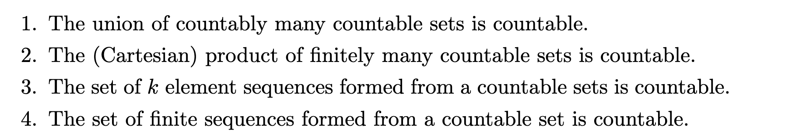

# Summary

## 1. Set theory
Conceptual:
1. equipotent/cardinality
2. THM: Cantor-Bernstein Theorem with proof
3. THM: finite set and a function
4. finite (alternative) by using $\prec$
5. countable

Problems:

---
## 2. Analysis II
Conceptual:
1. submanifold
2. regular value
3. regular value and submanifold (Regular Value Theorem)\
    recognise submanifold without coordinate change
4. Claim: $O(n)$ is a submanifold

Problems:

---
## 3. Deutsch

---
## 4. Classical Mechanics

---
## 5. Theoretical Neuroscience

---
# Review
1. Analysis\
    a. find derivative \
    b. implicit function theorem
2. Set theory\
    a. $\bigcup S$

# Unsolved Questions

# Questions for Tomorrow