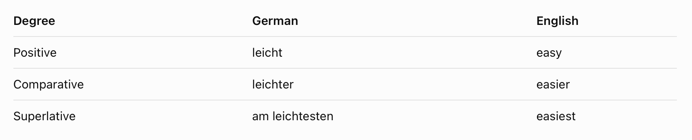
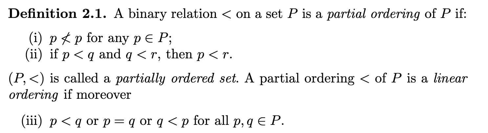
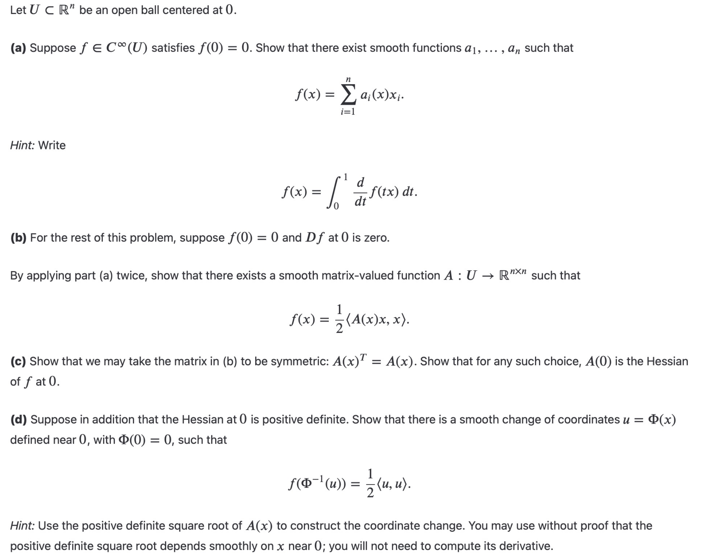
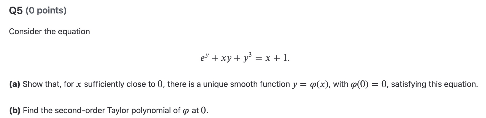
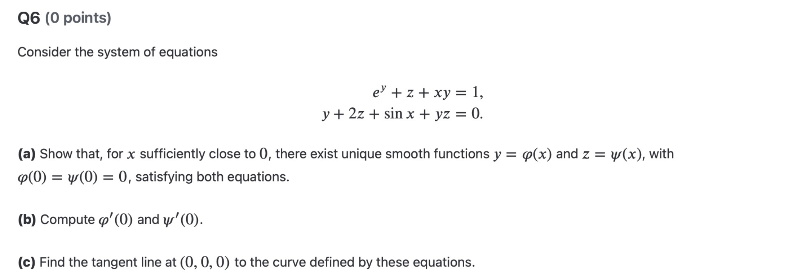

Unfinished

## Summary

### 1. Set theory
Conceptual:
1. equipotent/cardinality: exists a bijection between two sets
2. THM: Cantor-Bernstein Theorem\
    idea: find two injective functions, instead of a bijective one
3. THM: finite set and a function
    question
4. finite (alternative) by using $\prec$\
    def1: finite set: compare cardinality with $n\in\mathbb{N}$\
    def2: linear ordering in $X$ + greatest/least elem of the subset of $X$ Question
    recursion, natural number and 
5. countable: compare the cardinality with $|\mathbb{N}|$ (equipotent)

---
### 2. Analysis II
Conceptual:
1. submanifold: projecting the image to a 'level' set, reduce the dimension?? Question
2. regular value: Question
3. regular value and submanifold (Regular Value Theorem)\
    recognise submanifold without coordinate change 
    Question 

---
### 3. Deutsch
1. Es sagt: Für Englischsprachige gehören Spanisch, Französisch, und Italienish zu den leichtesten Sprachen.

2. Das FSI bringt amerikanischen Diplomaten Sprachen bei.

a. 

    gehören + zu + Dativ: to belong to / to be part of / to be among

Ich gehöre zu dieser Gruppe.\
I belong to this group.

Deutsch gehört zu den germanischen Sprachen.\
German belongs to the Germanic languages.

Sie gehört zu meinen besten Freunden.\
She is one of my best friends.

Spanisch gehört zu den leichtesten Sprachen für Englischsprachige.
Spanish is among the easiest languages for English speakers.

b.

    beibringen: to teach someone something
Meine Mutter bringt mir Deutsch bei.\
My mother teaches me German.

Kannst du mir das beibringen?\
Can you teach me that?

c.

    leichtesten: easiest / lightest

Deutsch ist leichter als Russisch.\
German is easier than Russian.

Diese Aufgabe ist am leichtesten.\
This exercise is the easiest.

Das ist der leichteste Weg.\
This is the easiest way.

Das gehört zu den leichtesten Aufgaben.\
That is among the easiest exercises.

`#AI`

---
### 4. Classical Mechanics
#### Non linear pendulum
Unfinished
---
## Review
1. Analysis
    1. implicit function theorem:\
    Question meaning of finding $y=f(x)$ (knowing the existence?)\
    $F(x,y)=0\iff y=f(x)$?
2. Set theory
    1. $\bigcup S$: \
    Axiom of Union\
    the element of the element in $S$\
    $u\in\bigcup S \iff u\in x\in S$ 
    2. Linear ordering with $\prec$:
        1. partial ordering of [a set]: take it as a normal $<$, cannot be obeyed by having both $p<q$ and $q<p$
        2. linear ordering of [a set]: partial ordering + all elem in the set can be ordered by $<,=,>$
    

## Unsolved Questions
1. Show that "$f[X]$ is a finite set for $f$ be a function and $X$ be a finite set. And $|f[X]|\leq |X|$." by constructing finite one-to-one seq with range $f[X]$ using recursion.
    1. one-to-one?
    2. why and how to use recursion?

## Questions for Tomorrow
1. Analysis

    HW4 Question 4cd:
    
    idea:

2. Analysis

    Hw4 Question 5:
    
    idea:

3. Analysis

    Hw4 Question 6:
    
    idea:  

4. Classical mechanics

    Approach to Chaos

    idea & question: 

5. Deutsch

    `zu`
6. Set Theory
    Proof of Cantor-Bernstein
7. Analysis\
    Claim: $O(n)$ is a submanifold