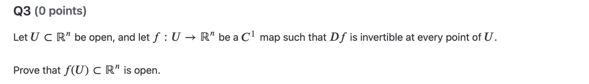
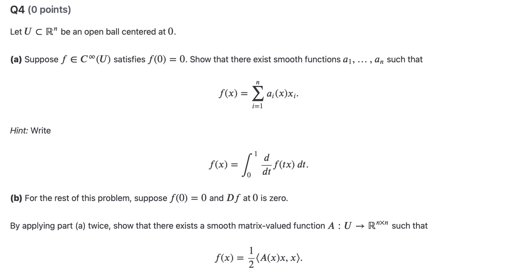

Unfinished

## Summary

### 1. Analysis II

Problems:
Homework 4 Question 3:

Homework 4 Question 4ab:

---
### 2. Set Theory

---
### 3. Classical Mechanics

---
### 4. Deutsch

---
## Review

## Unsolved Questions

## Questions for Tomorrow