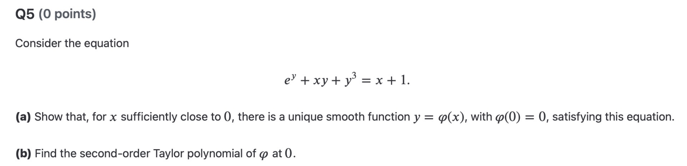

Unfinished

## Schedule and time
Goals:\
Finish MAT257 HW4 Q3,4ab(cd),5\
PHY254 lecture 16 notes

## Summary

### 1. Analysis II

Problems:
Homework 4 Question 3:

Homework 4 Question 4ab:

HW4 Q5:

---
### 2. Set Theory

---
### 3. Classical Mechanics

---
### 4. Deutsch
1. Um sie gut genug für die Arbeit zu sprechen, branchen die Kursteilnehmer dort etwa 600 bis 750 Stunden Unterricht.
    1. Um ... zu + infinitiv\
        in order to 
        - Ich lerne Deutsch, um in Deutschland zu arbeiten.
        - Ich lese jeden Tag, um meinen Wortschatz zu verbessern.
        - Ich gehe früh ins Bett, um morgen fit zu sein.
    2. genug\
        enough (adj. + genug)
        - Mein Deutsch ist noch nicht gut genug.
        - Das ist gut genug.
        - Ich bin alt genug, um Auto zu fahren.

        genug + noun
        - Wir haben genug Geld.
        - Ich habe genug Zeit.
        - Habe du genug Wasser?
    3. brauchen\
        to need
        - Brauchst du einen Stift?
        - Ich brauche mehr Zeit.
        - Wie lange brauchst du?
        - Ich brauche zwei Stunden, um meine Hausaufgaben zu machen?

2. `zu`
    1. zu + infinitiv\
        similar with `to + verb` in Englisch
        - Ich versuche, Deutsch zu lernen. (I try to learn German.)
        - Ich habe keine Zeit, zu schlafen.
        - Es ist schwer, Deutsch zu sprechen.

    2. zu + dativ\
        to/towards (direction)\
        - Ich gehen zur Schule.
        - Ich gehen zum Arzt (doctor). 
        - Komm zu mir.\
        Note: for dative, der - dem, die(f) - der, das - dem, die(p) - den\
        zur = zu + der, zum = zu + dem.

        belong to (gehören zu)
    3. zu + adj
        too
        - Das ist zu teuer.

---
## Review

---
## Remaining questions solved

---
## Questions for Tomorrow