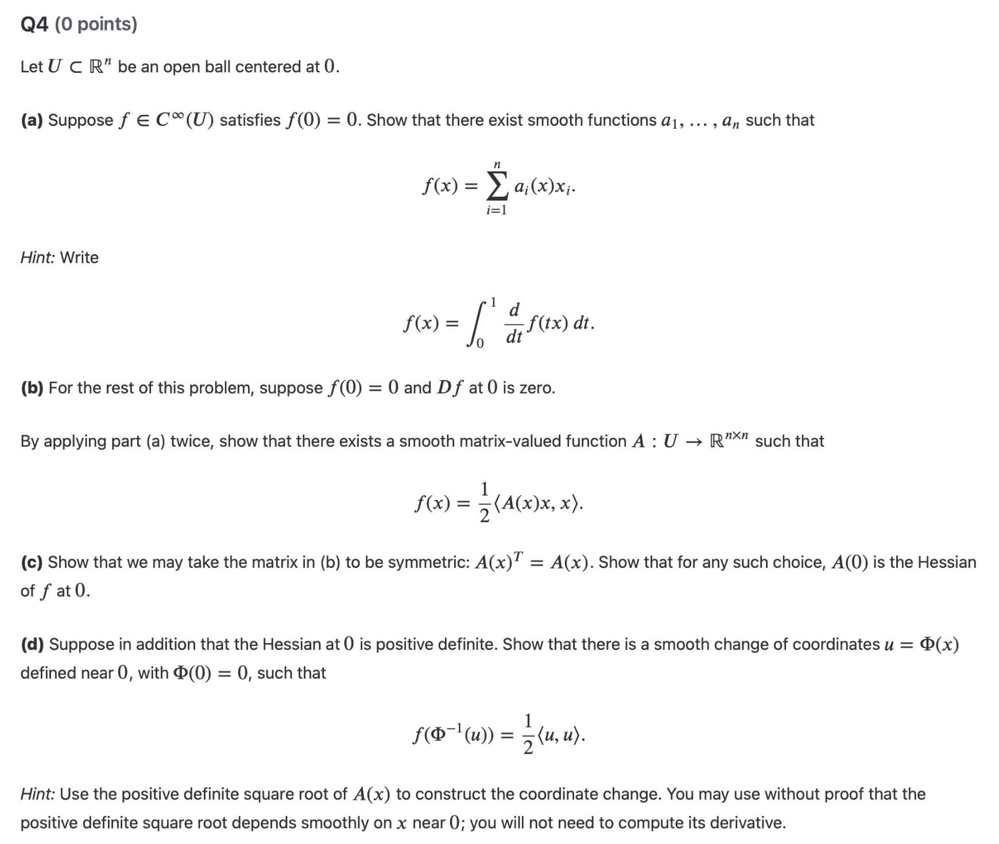
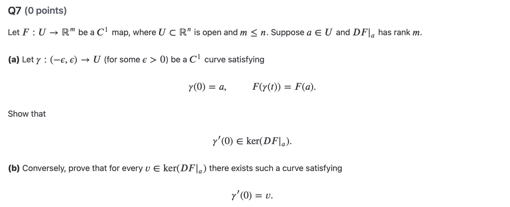

Unfinished | Streak: Day 3

## Schedule and time
Start time:
1. 12.00 MAT257 HW
2. 15.00 PHY254 Lecture notes 15, 16

Goals:
1. Finish MAT257 HW4 before 19.00
2. Finish PHY254 lecture notes 15,16 before 19.00
3. 5h study

Keep in mind:
1. No side requests before finishing the goals.

## Summary

### 1. Analysis II
Conceptual:
1. idea of manifolds: 

---
Problems:

HW4 Q4:

idea:

HW4 Q7:

idea: 

---
### 2. Set Theory
Problems:

---
### 3. Classical Mechanics

---
### 4. Deutsch
Cambridge English nennt Zalhen für jedes Niveau in Englisch.

Für A2 brauchst du etwa 180 bis 200 Stunden Unterricht mit einem Lehrer.

---
## Review
1. Rings and fields
2. Taylor polynomials and derivatives

---
## Questions for Tomorrow
Unfinished