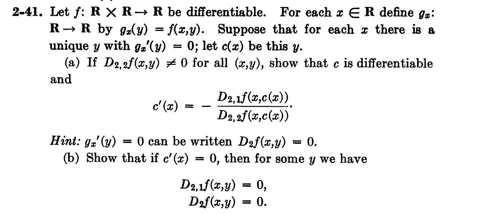

Unfinished | Streak: Day 6

## Schedule and time
goals:
1. Finished MAT257 notes 1h45m: spivak implicit function theorem + p2-40, 2-41; lecture notes submanifolds, spivak manifolds + spivak p5-1, 5-2
2. PHY254 notes 30m
3. Missed PHY254 pset 1h30m

Actual study:

## Summary

### 1. Analysis II
1. Implicit function theorem:\
purpose: find a unique $y$ given the open subset (definition of function)\
the purpose to let subset be open? Question \
also: it guarentees a differentiable function, so if the explicit expression cannot be found, the differentiation is meaningful.\
Problem for tomorrow (spivak) TMR :

2. Submanifolds:\
Idea: the subset(submanifold) can be perceived as linear space (Question what? and why?) by changing coordinate (review changing coordinate and IFT) locally\
Example: graph of function and relationship with ImpFT TMR\

3. Regular value:\
For $F: U(\mathbb{R}^n)\to \mathbb{R}^m$, $\mu\in \mathbb{R}^m$ (in image, the regular value), and $F(p)=\mu$ we want the derivative of $F$ at point $p$ to be surjective (Question purpose?)