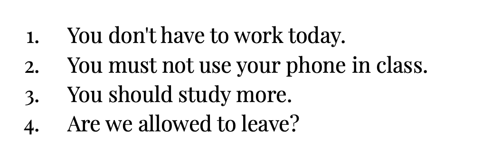

Unfinished | Streak: Day 9

## Schedule and time

## Summary

### 1. Analysis II

---
### 2. Set Theory

---
### 3. Classical Mechanics

---
### 4. Deutsch

1. Du musst heute nicht arbeiten.
2. Du darfst im Unterricht dein Handy nicht benutzen.
3. Du sollst mehr lernen.
4. Dürfen wir gehen?

---
## Review

---
## Other Questions

---
## Questions for Tomorrow